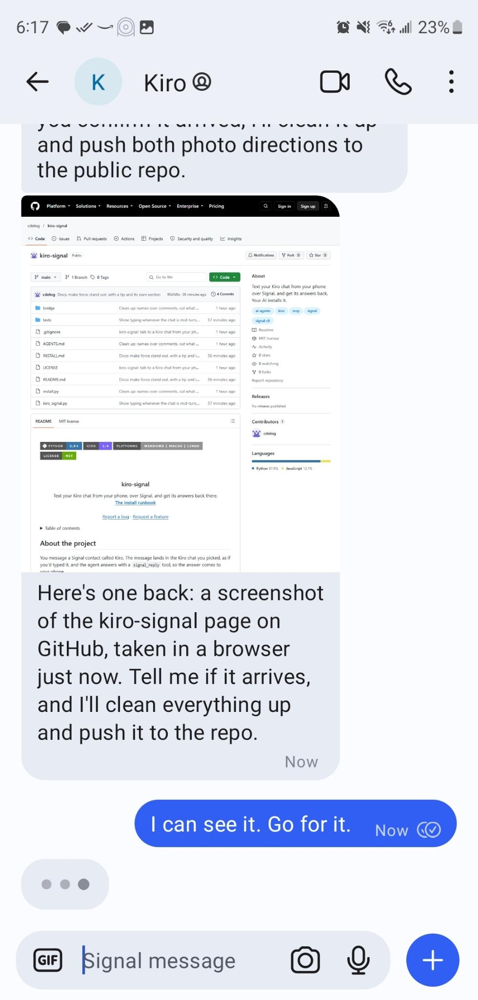

<a id="readme-top"></a>

<!-- Structure adapted from othneildrew/Best-README-Template, credited in Acknowledgments. -->

[![Python][python-shield]][python-url]
[![Kiro][kiro-shield]][kiro-url]
[![Platforms][platform-shield]](#prerequisites)
[![License][license-shield]][license-url]

<br />
<div align="center">
  <h3 align="center">kiro-signal</h3>

  <p align="center">
    Text your Kiro chat from your phone, over Signal, and get its answers back there.
    <br />
    <a href="INSTALL.md"><strong>The install runbook</strong></a>
    <br />
    <br />
    <a href="https://github.com/cdelog/kiro-signal/issues/new?labels=bug">Report a bug</a>
    &middot;
    <a href="https://github.com/cdelog/kiro-signal/issues/new?labels=enhancement">Request a feature</a>
  </p>
</div>

<details>
  <summary>Table of contents</summary>
  <ol>
    <li><a href="#about-the-project">About the project</a>
      <ul>
        <li><a href="#status">Status</a></li>
        <li><a href="#built-with">Built with</a></li>
      </ul>
    </li>
    <li><a href="#getting-started">Getting started</a>
      <ul>
        <li><a href="#prerequisites">Prerequisites</a></li>
        <li><a href="#installation">Installation</a></li>
      </ul>
    </li>
    <li><a href="#usage">Usage</a>
      <ul>
        <li><a href="#interrupting-a-turn-with-force">Interrupting a turn with force</a></li>
      </ul>
    </li>
    <li><a href="#repository-layout">Repository layout</a></li>
    <li><a href="#security">Security</a></li>
    <li><a href="#limits">Limits</a></li>
    <li><a href="#contributing">Contributing</a></li>
    <li><a href="#license">License</a></li>
    <li><a href="#acknowledgments">Acknowledgments</a></li>
  </ol>
</details>

## About the project

You message a Signal contact called Kiro. The message lands in the Kiro chat you picked, as if you'd typed it, and the agent answers with a `signal_reply` tool, so the answer comes to your phone.

<p align="center">
  
</p>

I built it to keep working with Kiro away from my desk. Signal does the status for free: delivered means your message is queued, read means it's in the chat, and typing means the chat is mid-turn, whoever started the turn. A message waits for the running turn to end, unless you start it with [`force:`](#interrupting-a-turn-with-force). Photos go both ways: one you send lands in the chat as an image, and the agent can send you a screenshot.

```
your phone --Signal--> signal-cli daemon, on 127.0.0.1
                         |-- events --> kiro_signal.py relay --> bridge extension --> your Kiro chat
                         '-- send   <-- kiro_signal.py mcp   <-- signal_reply    <-- the agent
```

<p align="right">(<a href="#readme-top">back to top</a>)</p>

### Status

- [x] The relay and the bridge. Their logic has carried my own messages every day since 20 October 2026, and this repository is a cleaned-up copy.
- [x] The installer on Windows 11 and Kiro 1.4.10, up to registration: the signal-cli download and checksum, finding Java, picking the chat, installing the extension.
- [x] Photos both ways, on Windows: one sent from a phone arrived in the chat as an image, and a screenshot of a web page came back.
- [ ] A fresh registration through the installer, from a new number.
- [ ] macOS.
- [ ] Linux.

If you're the first to try one of the unchecked lines, an issue saying how it went is a big help.

### Built with

- Python's standard library and nothing else. Python 3.9 or newer.
- A Kiro extension with no dependencies, packed by the installer, so there's no Node or vsce step.
- [signal-cli](https://github.com/AsamK/signal-cli), downloaded from its own releases at install time.

<p align="right">(<a href="#readme-top">back to top</a>)</p>

## Getting started

### Prerequisites

- Kiro, on Windows, macOS or Linux.
- Python 3.9 or newer, and Java 25 or newer for signal-cli. The agent installs either one if it's missing, and you accept the system prompt.
- **A phone number for the bot that isn't your own.** Registering a number signs out whatever Signal install uses it. A cheap prepaid SIM works, or any number that can take an SMS or a voice call.

### Installation

Open Kiro in the project you want to reach from your phone, start a chat, and paste:

```
Clone https://github.com/cdelog/kiro-signal to ~/kiro-signal and install it by following its INSTALL.md. Connect it to this chat.
```

The agent runs the setup and checks each step. It stops four times for things only you can do:

1. Tell it the bot's phone number.
2. Solve a captcha in your browser, and paste back the link it gives you.
3. Read out the code Signal sends to that number.
4. Text the bot one word from your phone, so it knows which account is yours.

It takes about 15 minutes, most of it the signal-cli download and waiting for the code.

<p align="right">(<a href="#readme-top">back to top</a>)</p>

## Usage

> [!TIP]
> **Need the agent now?** Start your message with `force:`. It stops the running turn and puts your message in straight away.

- **Send anything.** If the agent is mid-turn, your message waits for the turn to end. Messages that wait go in together.
- **Send photos and files.** A photo goes in as an image, as if you'd dragged it into the chat. Any other file arrives as a path the agent can open. The agent can send you files too, such as a screenshot.
- **Turn on Read receipts and Typing indicators** in Signal, under Settings, Privacy, to see the marks. You only get words when something fails.
- **Keep the computer on and that Kiro window open.** A message sent while Kiro is closed waits, and goes in when the window opens.

`python install.py doctor` shows what's set up and running, and the next command to run. `python install.py -h` lists every command.

### Interrupting a turn with force

| You send                              | What happens                                                          |
| ------------------------------------- | --------------------------------------------------------------------- |
| `force: stop and look at the CI logs` | Stops the running turn, then puts in everything queued, and this text |
| `force`                               | Stops the running turn, then puts in everything queued                |
| `flush`                               | The same as `force`                                                   |
| `Force push the branch`               | An ordinary message                                                   |

Capitals don't matter, but the keyword counts only on its own, or followed by `:` or a new line. It stops the turn the way the chat's Stop button does. If the turn hasn't stopped after 60 seconds, your messages wait for it to end, and you get one message saying so.

<p align="right">(<a href="#readme-top">back to top</a>)</p>

## Repository layout

| Path             | What it is                                                                                               |
| ---------------- | -------------------------------------------------------------------------------------------------------- |
| `kiro_signal.py` | The relay, which queues your messages and hands them to the chat, and the MCP server with `signal_reply` |
| `bridge/`        | The Kiro extension that types a message into the chat, and says when the chat is busy                    |
| `install.py`     | The installer. Every step is one command that never prompts, so an agent can run it                      |
| `INSTALL.md`     | The runbook the agent follows, including what to ask you and when                                        |
| `tests/`         | Self-checks for both Python files. No network, signal-cli or Kiro                                        |

Everything kiro-signal writes lives in `~/.kiro-signal`, except for one entry in Kiro's `mcp.json`, the extension, and the autostart entry. Set `KIRO_SIGNAL_HOME` to put it somewhere else.

<p align="right">(<a href="#readme-top">back to top</a>)</p>

## Security

Read this before you install.

- **A Signal message becomes a prompt on your computer.** If the agent runs with tools approved automatically, a message can do anything the agent can.
- **Only your account gets through.** The relay accepts direct messages from one Signal account, checked by the account ID that Signal authenticates. It drops messages from anyone else, and group messages.
- **Anyone holding one of your Signal devices can drive your agent.** Check Signal's Linked devices, and turn on Registration Lock for your own account.
- **Text the agent reads is the bigger risk.** Web pages, issues and emails can carry instructions. That's true without kiro-signal too, but you aren't watching when you're away, so only auto-approve tools you'd trust unattended.
- **Replies reach only you.** `signal_reply` sends to your account whatever arguments it gets. It can attach any file the agent names, so a prompt that tricks the agent could send you one of your own files, and no one else.
- **Everything listens on 127.0.0.1.** The signal-cli daemon's HTTP API has no authentication, so any program on your computer can send as the bot. The bridge needs a random token and refuses other Host headers, so a web page can't reach it.
- **`~/.kiro-signal/signal-data` holds the bot's identity keys.** Anything that can read it can pose as the bot.
- **The installer checks signal-cli before installing it.** The download must match the SHA-256 GitHub publishes for the release.

<p align="right">(<a href="#readme-top">back to top</a>)</p>

## Limits

- **It's unofficial.** Signal has no bot API, and signal-cli isn't Signal's. A bot number can hit rate limits or captchas, and signal-cli releases stop working after about three months. `install.py doctor` warns you, and `install.py signal-cli` updates it.
- **The bridge relies on three Kiro internals with no documentation**, listed at the top of `bridge/extension.js`. A Kiro update can break it. Your messages stay queued until it's fixed.
- **One chat.** No reactions or groups, and the agent can't listen to a voice note: it arrives as a file.
- **Updating the extension takes a window reload**, which ends a running turn.

<p align="right">(<a href="#readme-top">back to top</a>)</p>

## Contributing

Issues and pull requests are welcome. Keep it to the standard library and one extension with no dependencies, and run both self-checks before you open a PR:

```
python tests/test_kiro_signal.py
python tests/test_install.py
```

<p align="right">(<a href="#readme-top">back to top</a>)</p>

## License

MIT. See [`LICENSE`](LICENSE). signal-cli is GPL-3.0. The installer downloads it from its own releases, and this repository doesn't include it. kiro-signal isn't affiliated with Signal, Kiro or AWS.

<p align="right">(<a href="#readme-top">back to top</a>)</p>

## Acknowledgments

- [signal-cli](https://github.com/AsamK/signal-cli) by AsamK, which does the hard part.
- [Best-README-Template](https://github.com/othneildrew/Best-README-Template) by othneildrew, for this README's structure.
- [Shields.io](https://shields.io) for the badges.

<p align="right">(<a href="#readme-top">back to top</a>)</p>

[python-shield]: https://img.shields.io/badge/python-3.9+-3776AB?style=for-the-badge&logo=python&logoColor=white
[python-url]: https://docs.python.org/3/library/
[kiro-shield]: https://img.shields.io/badge/kiro-1.4-7B61FF?style=for-the-badge
[kiro-url]: https://kiro.dev
[platform-shield]: https://img.shields.io/badge/platforms-windows_|_macos_|_linux-lightgrey?style=for-the-badge
[license-shield]: https://img.shields.io/badge/license-MIT-green?style=for-the-badge
[license-url]: LICENSE
